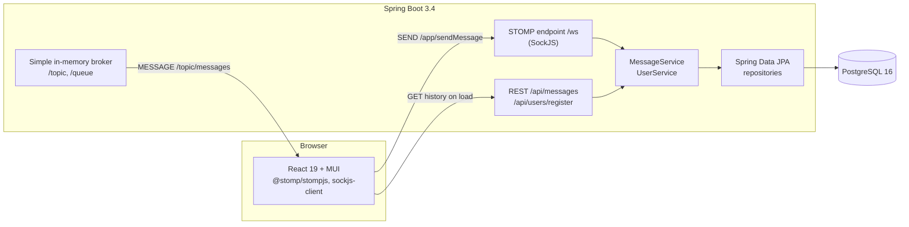

# Real-Time Chat Application

A group chat where messages travel over STOMP on WebSocket (with a SockJS fallback) between a React client and a Spring Boot backend, and are stored in PostgreSQL.

## Architecture



A user joins with a name (`POST /api/users/register`); the client then loads the message history over REST and opens a STOMP session over SockJS. When the user sends a message to `/app/sendMessage`, the backend validates it (non-blank content of at most 5000 characters, a registered sender), saves it in PostgreSQL in its own transaction, and only then broadcasts the saved message, with its id and server timestamp, to every subscriber of `/topic/messages`. A rejected message is not saved or broadcast; the reason goes back to the sender alone on `/user/queue/errors`. On every page load the client fetches the latest messages from `GET /api/messages`, so a reconnecting user sees what was sent while they were away.

## Features

- Join under a display name; the same name returns the same user. There are no passwords or authentication.
- Real-time group messages over STOMP, with SockJS falling back to HTTP streaming or polling where WebSocket is not available.
- Every message is stored in PostgreSQL before it is broadcast; the history endpoint returns the latest messages (50 by default, up to 100), oldest first.
- Server-side validation of messages and usernames, with the reason shown to the sender in the UI.
- Each client's frames are handled in the order they arrive, so one user's messages are saved and broadcast in the order they were sent.
- Allowed browser origins for both the REST API and the STOMP endpoint come from configuration; other origins get `403`.

## Tech stack

Versions as resolved from `pom.xml` and `chat-frontend/package-lock.json`.

| Part | Technology |
|---|---|
| Backend | Java 17 (compiled; the Docker image runs on Temurin 21 JRE), Spring Boot 3.4.11 (Spring Framework 6.2.12, embedded Tomcat 10.1.48) |
| Messaging | Spring WebSocket + STOMP, SockJS, Spring's simple in-memory broker |
| Persistence | Spring Data JPA, Hibernate 6.6.33, PostgreSQL JDBC driver 42.7.8, PostgreSQL 16 |
| Validation | Jakarta Bean Validation (Hibernate Validator) |
| Backend tests | JUnit 5.11.4, Mockito 5.14.2, AssertJ, Testcontainers 1.21.4 |
| Frontend | React 19.2.4, MUI 6.5.0, @stomp/stompjs 7.2.1, sockjs-client 1.6.1, Create React App (react-scripts 5.0.1) |
| Frontend tests | Jest 27 (via react-scripts), React Testing Library 16.3.2 |
| Build and run | Maven 3.9.9 (wrapper), Docker multi-stage builds, Docker Compose, Nginx (serves the React build), GitHub Actions |

## Run with Docker Compose

Requires Docker.

```bash
docker compose up --build
```

Open http://localhost:3000, enter a name and start chatting; open a second browser window to see messages arrive in real time. The backend listens on http://localhost:8080 and PostgreSQL on `127.0.0.1:5432`. If port 5432 is already taken by a local PostgreSQL, choose another one: `POSTGRES_PORT=5434 docker compose up --build`.

Data is kept in the `pgdata` volume; `docker compose down -v` removes it.

## Run locally without Docker

Requires JDK 17 or 21 (CI and the Docker image use 21), Node.js 18 or newer and a PostgreSQL database.

1. Create a database and user (or start only the database from Compose: `docker compose up -d postgres`):

   ```sql
   CREATE USER chatuser WITH PASSWORD 'chatpass';
   CREATE DATABASE chatdb OWNER chatuser;
   ```

2. Start the backend (Hibernate creates the tables on first start):

   ```bash
   ./mvnw spring-boot:run          # Windows: mvnw.cmd spring-boot:run
   ```

   Set `DB_URL`, `DB_USERNAME` and `DB_PASSWORD` if your database differs from the defaults below.

3. Start the frontend in a second terminal:

   ```bash
   cd chat-frontend
   npm ci
   npm start                        # http://localhost:3000
   ```

## Configuration

The backend reads these environment variables (see `src/main/resources/application.properties`); `.env.example` lists them for Docker Compose.

| Variable | Default | Purpose |
|---|---|---|
| `PORT` | `8080` | HTTP port of the backend |
| `DB_URL` | `jdbc:postgresql://localhost:5432/chatdb` | JDBC URL of the database |
| `DB_USERNAME` | `chatuser` | Database user |
| `DB_PASSWORD` | `chatpass` | Database password (a local default; set your own anywhere else) |
| `JPA_DDL_AUTO` | `update` | Hibernate schema handling (`update`, `validate`, ...) |
| `CORS_ALLOWED_ORIGINS` | `http://localhost:3000` | Comma-separated browser origins allowed to call the API and open `/ws`; patterns such as `http://localhost:*` work |

Docker Compose also reads `POSTGRES_DB`, `POSTGRES_USER`, `POSTGRES_PASSWORD` (defaults `chatdb`, `chatuser`, `chatpass`), `POSTGRES_PORT` (`5432`) and `REACT_APP_API_URL` (`http://localhost:8080`, compiled into the frontend bundle at build time).

## API

### STOMP over SockJS

| | Destination | Payload |
|---|---|---|
| Endpoint | `/ws` (SockJS) | |
| Send | `/app/sendMessage` | `{"content": "Hello", "user": {"id": 1}}` |
| Subscribe | `/topic/messages` | every saved message, see below |
| Subscribe | `/user/queue/errors` | the reason a message you sent was rejected |

A message broadcast on `/topic/messages`:

```json
{"id": 12, "content": "Hello", "timestamp": "2026-10-14T18:05:32.353Z", "user": {"id": 1, "username": "alice"}}
```

A rejection on `/user/queue/errors` (only the sender receives it):

```json
{"error": "Message content must not be blank"}
```

Rejection reasons: blank content, content longer than 5000 characters, a missing sender, a sender id that is not registered, a body that cannot be read as a chat message.

### REST

`POST /api/users/register` returns the user with that name, creating it on first use (the name is trimmed; 1 to 50 characters).

```bash
curl -X POST http://localhost:8080/api/users/register \
  -H "Content-Type: application/json" -d '{"username": "alice"}'
```

```json
{"id": 1, "username": "alice"}
```

`400` with `{"error": "Username must not be blank"}` or `{"error": "Username must be at most 50 characters"}` for an invalid name.

`GET /api/messages?limit=50` returns the latest `limit` messages (default 50, clamped to 1..100), oldest first.

```bash
curl http://localhost:8080/api/messages
```

```json
[
  {"id": 11, "content": "Hi all", "timestamp": "2026-10-14T18:04:10.120Z", "user": {"id": 2, "username": "bob"}},
  {"id": 12, "content": "Hello", "timestamp": "2026-10-14T18:05:32.353Z", "user": {"id": 1, "username": "alice"}}
]
```

`400` with `{"error": "Parameter 'limit' has an invalid value"}` when `limit` is not a number.

## Testing

```bash
./mvnw verify                      # backend; needs a running Docker for Testcontainers
cd chat-frontend && npm test       # frontend
```

| Level | Tests | What they cover |
|---|---|---|
| Unit (JUnit 5 + Mockito) | `MessageServiceTest`, `UserServiceTest` | saving a message with its sender and the server time, rejecting an unknown sender, history order and limit clamping, registering an existing or new name, two requests racing for the same name |
| Unit (Bean Validation) | `RequestValidationTest` | the rules on the STOMP payload and the registration body |
| Repository (`@DataJpaTest`, PostgreSQL 16 in Testcontainers) | `MessageRepositoryTest` | the latest-first history query with senders fetched in the same query, rows without a sender, the unique username constraint |
| Integration (`@SpringBootTest` on a random port, PostgreSQL in Testcontainers) | `ChatIntegrationTest` | a STOMP client over SockJS sends a message, a second client receives the broadcast, the row is in the database and `GET /api/messages` returns it; invalid and unreadable messages reach only the sender's error queue and are neither broadcast nor saved |
| Frontend (Jest + React Testing Library) | `App.test.js`, `Chat.test.js` | the join form, the Join button state, the history request on mount (STOMP and SockJS are mocked) |

CI (`.github/workflows/ci.yml`) runs the backend suite with `./mvnw -B verify` and the frontend tests and production build on every push to `main` and every pull request.

## Project structure

```text
.
├── src/main/java/com/bogdusik/chat
│   ├── ChatApplication.java
│   ├── config/            WebSocketConfig (STOMP, SockJS, broker), WebConfig (CORS, clock), ChatProperties
│   ├── controller/        ChatController (STOMP), MessageController, UserController, ApiExceptionHandler
│   ├── service/           MessageService, UserService, UnknownUserException
│   ├── repository/        MessageRepository, UserRepository
│   ├── entity/            Message, User
│   └── dto/               SendMessageRequest, MessageResponse, RegisterUserRequest, UserResponse, ErrorResponse
├── src/main/resources/application.properties
├── src/test/java/com/bogdusik/chat
│   ├── ChatIntegrationTest.java
│   ├── TestcontainersConfiguration.java
│   ├── dto/RequestValidationTest.java
│   ├── repository/MessageRepositoryTest.java
│   └── service/           MessageServiceTest, UserServiceTest
├── chat-frontend/         React app (src/Chat.js), its tests, Dockerfile, nginx.conf
├── Dockerfile             backend image
├── docker-compose.yml     postgres, backend, frontend
├── .env.example
├── pom.xml, mvnw, mvnw.cmd, .mvn/
└── .github/workflows/ci.yml
```

## Design decisions

**STOMP instead of raw WebSocket.** A raw WebSocket only carries frames; routing, subscriptions and message types would have to be invented on top. STOMP gives destinations (`/app/...` for messages to the server, `/topic/...` for broadcasts, `/user/queue/...` for replies to one session), and Spring maps them to annotated controller methods the same way it maps HTTP requests, including validation and exception handlers.

**SockJS fallback.** Some proxies and networks block the WebSocket upgrade. SockJS tries WebSocket first and falls back to HTTP streaming or long polling with the same API on both sides, so the client code does not change. The cost is an extra `/ws/info` request on connect and a SockJS-specific URL scheme, which is why plain WebSocket clients have to use `/ws/websocket`.

**The simple in-memory broker, and what changes with several instances.** Spring's simple broker keeps subscriptions in the memory of one JVM, which is enough for a single instance. With two or more instances behind a load balancer, a message received by one instance would only reach the clients connected to that instance. The fix is to replace `enableSimpleBroker` with `enableStompBrokerRelay` pointing at an external STOMP broker such as RabbitMQ (with its STOMP plugin), so every instance publishes to and receives from the same broker; the controllers do not change.

**Persist, then broadcast.** `MessageService.send` saves the message in its own transaction and returns the saved row; the controller broadcasts that return value. A client therefore never sees a message that is not in the database, and the broadcast carries the database id and the server timestamp, so it matches what `GET /api/messages` returns later. If the save fails, nothing is broadcast and the sender gets an error.

## What I learned

- Spring's `@MessageMapping` methods get the same treatment as HTTP handlers: `@Valid` on the payload, `@MessageExceptionHandler`, and `@SendToUser` to answer only the session that sent the frame, which works for anonymous sessions as well.
- By default Spring handles the frames of one WebSocket session on several threads, so a `SUBSCRIBE` followed by a `SEND` is not guaranteed to be processed in that order; `setPreserveReceiveOrder(true)` fixes it, and the integration test only passed reliably after I understood that.
- Exposing JPA entities in responses breaks in quiet ways: a lazy association serialises as a Hibernate proxy. Mapping to records (DTOs) at the service boundary removed that class of bug and decoupled the wire format from the schema.
- Timestamps need one precision end to end: the JVM clock had sub-microsecond digits, PostgreSQL keeps microseconds, so the broadcast and the history disagreed until the service truncated to milliseconds.
- Testcontainers runs the repository and integration tests against the same PostgreSQL version as Docker Compose; it also showed that the Testcontainers version managed by Spring Boot 3.4.11 is too old for Docker Engine 29.
